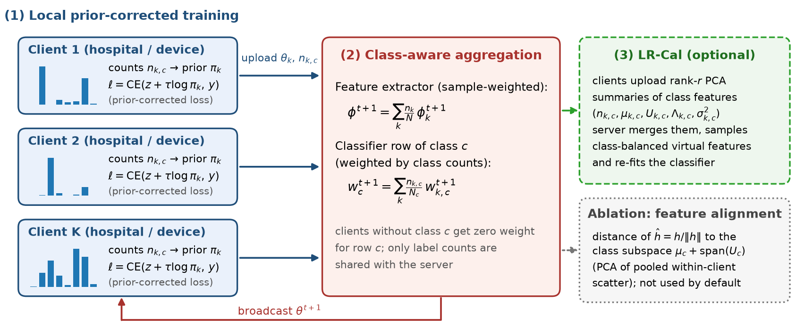

# FedCARE — Class-Aware Recalibration for Federated Medical Image Classification

Code, configurations, raw results and manuscript generator for

> A. Fathi, R. Boostani, R. Hosseini, and M. A. Mohammed, **"FedCARE: Class-Aware Recalibration for Federated Medical Image Classification under Label Skew and Acquisition Shift."**



Under label skew, federated averaging (FedAvg) averages the classifier row of every class with clients that never observed that class, which shrinks the class's update by the share of data held by the clients that did (Proposition 1 in the paper). **FedCARE** fixes this with two cheap changes:

1. **Prior-corrected local loss** — `CE(z + log π_k, y)` with the client's smoothed label prior `π_k` (balanced softmax). Rows of locally absent classes become inert instead of being suppressed.
2. **Class-aware classifier aggregation** — row `c` of the global classifier is the average of the clients' rows `c`, weighted by their counts of class `c`. The feature extractor is averaged as in FedAvg.

FedCARE uploads only the `C` label counts in addition to the model and has no tuned hyper-parameter.
The repository also contains **LR-Cal**, a post-hoc classifier calibration that transmits rank-`r` PCA summaries of class-conditional features instead of the full covariances used by CCVR, and the PCA **subspace-alignment** variant evaluated (negatively) as an ablation.

## Results (CPU study, 10 clients, 3 seeds, final round, full official test sets)

**Blood-shift** (BloodMNIST, Dirichlet α = 0.1 + simulated per-site stain/optics shift)

| Method | Acc | Bal. acc | Macro-F1 | Macro-AUC | Worst-class recall | n |
|---|---|---|---|---|---|---|
| FedAvg | 0.421 ± 0.041 | 0.383 ± 0.026 | 0.291 ± 0.013 | 0.841 ± 0.023 | 0.000 ± 0.000 | 3 |
| FedProx | 0.451 ± 0.164 | 0.395 ± 0.140 | 0.321 ± 0.164 | 0.901 ± 0.026 | 0.000 ± 0.000 | 3 |
| SCAFFOLD | 0.487 ± 0.246 | 0.503 ± 0.199 | 0.433 ± 0.237 | 0.915 ± 0.063 | 0.010 ± 0.009 | 3 |
| FedNova | 0.373 ± 0.125 | 0.347 ± 0.089 | 0.241 ± 0.104 | 0.895 ± 0.029 | 0.000 ± 0.000 | 3 |
| MOON | 0.418 ± 0.112 | 0.350 ± 0.090 | 0.289 ± 0.091 | 0.878 ± 0.044 | 0.000 ± 0.000 | 3 |
| FedRS | 0.476 ± 0.161 | 0.462 ± 0.141 | 0.395 ± 0.195 | 0.913 ± 0.031 | 0.041 ± 0.037 | 3 |
| FedLC | 0.463 ± 0.224 | 0.439 ± 0.232 | 0.387 ± 0.257 | 0.888 ± 0.094 | 0.036 ± 0.061 | 3 |
| FedAvg+CCVR | 0.389 ± 0.128 | 0.397 ± 0.078 | 0.316 ± 0.089 | 0.859 ± 0.057 | 0.003 ± 0.005 | 3 |
| FedAvg+LR-Cal | 0.392 ± 0.126 | 0.397 ± 0.072 | 0.318 ± 0.084 | 0.859 ± 0.056 | 0.003 ± 0.005 | 3 |
| FedCARE (ours) | 0.507 ± 0.228 | 0.498 ± 0.210 | 0.443 ± 0.247 | 0.901 ± 0.055 | 0.119 ± 0.109 | 3 |

**Derma** (DermaMNIST, α = 0.3, naturally long-tailed)

| Method | Acc | Bal. acc | Macro-F1 | Macro-AUC | Worst-class recall | n |
|---|---|---|---|---|---|---|
| FedAvg | 0.684 ± 0.007 | 0.173 ± 0.015 | 0.164 ± 0.024 | 0.849 ± 0.009 | 0.000 ± 0.000 | 3 |
| FedProx | 0.685 ± 0.004 | 0.172 ± 0.016 | 0.164 ± 0.027 | 0.848 ± 0.008 | 0.000 ± 0.000 | 3 |
| SCAFFOLD | 0.642 ± 0.025 | 0.171 ± 0.031 | 0.144 ± 0.022 | 0.756 ± 0.028 | 0.000 ± 0.000 | 3 |
| FedNova | 0.670 ± 0.003 | 0.174 ± 0.055 | 0.147 ± 0.057 | 0.807 ± 0.028 | 0.000 ± 0.000 | 3 |
| MOON | 0.682 ± 0.007 | 0.170 ± 0.016 | 0.157 ± 0.024 | 0.843 ± 0.013 | 0.000 ± 0.000 | 3 |
| FedRS | 0.687 ± 0.002 | 0.181 ± 0.011 | 0.178 ± 0.021 | 0.850 ± 0.008 | 0.000 ± 0.000 | 3 |
| FedLC | 0.693 ± 0.006 | 0.206 ± 0.036 | 0.209 ± 0.047 | 0.848 ± 0.010 | 0.000 ± 0.000 | 3 |
| FedAvg+CCVR | 0.519 ± 0.003 | 0.431 ± 0.022 | 0.338 ± 0.012 | 0.823 ± 0.007 | 0.173 ± 0.043 | 3 |
| FedAvg+LR-Cal | 0.518 ± 0.010 | 0.435 ± 0.020 | 0.338 ± 0.012 | 0.825 ± 0.005 | 0.188 ± 0.025 | 3 |
| FedCARE (ours) | 0.548 ± 0.071 | 0.399 ± 0.001 | 0.319 ± 0.029 | 0.822 ± 0.019 | 0.023 ± 0.040 | 3 |

**FedCARE vs. baselines (macro-F1, paired over settings × seeds)**

| Baseline | n | mean diff | wins | Wilcoxon p | paired t p |
|---|---|---|---|---|---|
| FedAvg | 6 | +0.153 | 5/6 | 0.0938 | 0.0670 |
| FedProx | 6 | +0.138 | 6/6 | 0.0312 | 0.0275 |
| SCAFFOLD | 6 | +0.092 | 5/6 | 0.0938 | 0.0869 |
| FedNova | 6 | +0.187 | 6/6 | 0.0312 | 0.0086 |
| MOON | 6 | +0.158 | 5/6 | 0.0625 | 0.0390 |
| FedRS | 6 | +0.094 | 4/6 | 0.1562 | 0.0383 |
| FedLC | 6 | +0.083 | 6/6 | 0.0312 | 0.0194 |
| FedAvg+CCVR | 6 | +0.054 | 3/6 | 0.8438 | 0.3604 |
| FedAvg+LR-Cal | 6 | +0.053 | 3/6 | 0.8438 | 0.3748 |

Mean ± s.d. over three seeds (each seed re-draws subsample, partition, site shift and initialisation). FedCARE is the strongest training-time method on average; results under α = 0.1 vary strongly across partitions, and on DermaMNIST post-hoc calibration of FedAvg (CCVR / LR-Cal) is at least as good — see the paper's discussion. Ablation (macro-F1, Blood/Derma): full 0.443/0.319, w/o prior correction 0.215/0.204, w/o class-aware head 0.426/0.317, + subspace alignment 0.384/0.307, + LR-Cal 0.336/0.339.

Full per-class precision/recall/F1, confusion matrices and every per-run file are in `results/`.

## Installation

```bash
git clone https://github.com/alirezafathi84/FedCARE.git && cd FedCARE
pip install -r requirements.txt          # PyTorch >= 2.0 (CPU or GPU)
python scripts/download_data.py --datasets bloodmnist dermamnist   # official MedMNIST v2 files, MD5-verified
pytest -q tests                          # 20 unit / end-to-end tests (~15 s)
```

Every dataset file is checked against the MD5 checksum published by `medmnist`; a modified copy is rejected.

## Reproducing the paper

```bash
python scripts/run_grid.py configs/grids/main.yaml   # 72 federated runs (resumable; ~45 min on 1 CPU core)
python scripts/summarize.py                          # tables, Wilcoxon / t-tests -> results/summary/
python scripts/make_figures.py                       # figures -> results/figures/
node paper/build_manuscript.js paper/FedCARE_manuscript.docx   # manuscript (npm install docx)
```

Single runs and overrides:

```bash
python scripts/run.py --setting blood-shift --method fedcare --seed 0
python scripts/run.py --setting derma --method fedcare --seed 1 --hp beta=0.5 rank=4 --tag fedcare+align
python scripts/run.py --setting blood-shift --method scaffold --seed 0 --train rounds=50 local_epochs=2
```

Methods: `fedavg` (also reports post-hoc `fedavg+ccvr` and `fedavg+lrcal`), `fedprox`, `scaffold`, `fednova`, `moon`, `fedrs`, `fedlc`, `fedcare` (also reports `fedcare+lrcal`).
Settings: `blood-shift`, `derma` (used in the paper), `path-stain` (PathMNIST; its official test split comes from a different clinical centre), `organ-views` (OrganA/C/SMNIST as three natural imaging-plane domains), `blood`.

## GPU-scale and external-centre replication

The paper's experiments were run on a single CPU core with a 24k-parameter CNN. For a larger study:

```bash
python scripts/download_data.py --datasets pathmnist organamnist organcmnist organsmnist
python scripts/run_grid.py configs/grids/extended.yaml      # PathMNIST external centre + OrganMNIST views, 5 seeds
python scripts/run.py --setting path-stain --method fedcare --seed 0 \
       --train model=resnet18 rounds=100 local_epochs=2 channels_last=false
```

Set `threads` in `configs/train.yaml` to use more CPU cores. Device placement is CPU by default; the code is plain PyTorch, so moving the runner to CUDA only requires `.to(device)` calls in `fedcare/runner.py`.

## Fairness of the comparison

* identical subsample, Dirichlet partition, site shift and initialisation for every method of a given seed;
* identical local optimiser (SGD, lr 0.05, momentum 0.9, wd 5e-4, batch 32, 1 local epoch, 25 rounds);
* baseline hyper-parameters are the defaults of the original papers (`configs/methods.yaml`);
* SCAFFOLD's control variates and FedNova's normaliser use the effective number of heavy-ball steps, because all methods use momentum SGD;
* final-round metrics on the full official test split — no model selection on test data.

## Repository structure

```
fedcare/      data.py (MedMNIST loading, Dirichlet partition, stain/optics site shift)
              models.py (compact CNN, ResNet-18) · algorithms.py (all FL methods)
              stats.py (low-rank class statistics, exact merge, subspaces, calibration)
              runner.py (simulation loop, metrics, logging)
configs/      train.yaml · methods.yaml · settings/*.yaml · grids/*.yaml
scripts/      run.py · run_grid.py · summarize.py · make_figures.py · download_data.py
tests/        partitioning, stain model, exact statistic merging, aggregation rules, end-to-end runs
results/      raw/<setting>/<method>/seed*.json · summary/ · figures/
paper/        build_manuscript.js · results_text.js · references.js
```

## Citation

See `CITATION.cff`. Licensed under the MIT License.
# FedCARE

